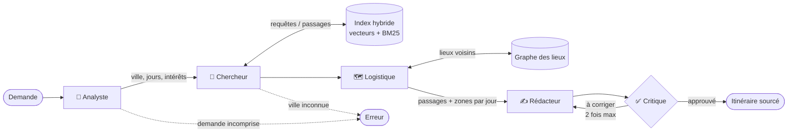

# Travel Agents 🧭

Planificateur de voyage **multi-agents** avec **RAG hybride**, qui tourne **100 % en local** :
données ouvertes (Wikivoyage), LLM local via [Ollama](https://ollama.com), aucun service payant.

Exemple de déroulement (illustratif) :

```
Vous > 3 jours à Lisbonne, j'aime les musées et la cuisine

🧭 Analyste : Lisbonne, 3 jours, intérêts : musées, cuisine
🔎 Chercheur : 9 passages trouvés (requêtes : musées d'art, restaurants de poisson, ...)
🗺️  Logistique : 8 lieux localisés en 3 zones, 2 lieux proches ajoutés
✍️  Rédacteur : version 1 rédigée
🔁 Critique : à corriger — L'itinéraire doit contenir exactement les jours 1 à 3 (trouvés : [1, 2]).
✍️  Rédacteur : version 2 rédigée
✅ Critique : itinéraire approuvé

Jour 1 — Belém
- Tour de Belém, chef-d'œuvre manuélin au bord du Tage [1]
...
```

> 🚧 Projet en cours de construction.

## Points clés

- **Multi-agents orchestrés avec [LangGraph](https://github.com/langchain-ai/langgraph)** : 5 agents spécialisés, avec une boucle de correction entre le Critique et le Rédacteur.
- **RAG agentique** : c'est un agent qui décide quoi chercher dans la base de connaissances.
- **Recherche hybride** : similarité vectorielle (sens) + BM25 (mots-clés) + filtres (ville, section), fusionnés par *Reciprocal Rank Fusion*.
- **Graphe des lieux** : les lieux proches à pied sont reliés ; le graphe sert à ajouter des lieux voisins
  de ceux trouvés (expansion par le graphe) et à regrouper les visites par quartier.
- **Réponses sourcées** : chaque lieu de l'itinéraire cite le passage du guide dont il vient.
- **100 % local** : Internet ne sert qu'à télécharger les données et les modèles une fois.
- **Indépendant du modèle** : LLM et embeddings interchangeables via le fichier `.env`.
- **Testable sans modèle** : un faux LLM et un faux modèle d'embeddings permettent de tester toute la logique.

## Architecture



| Agent | Rôle |
|---|---|
| **Analyste** | Transforme la demande en texte libre en données structurées (JSON validé par Pydantic) |
| **Chercheur** | Génère des requêtes de recherche à partir des centres d'intérêt et interroge l'index |
| **Logistique** | Sans LLM : localise les lieux trouvés, ajoute des lieux voisins grâce au graphe, et les répartit en zones (arbre couvrant minimal) |
| **Rédacteur** | Rédige l'itinéraire jour par jour en citant ses sources ; le corrige selon les remarques du Critique |
| **Critique** | Vérifie d'abord des règles automatiques (nombre de jours, sources existantes), puis demande l'avis du LLM sur la qualité |

### Pipeline des données

```
Wikivoyage ──► data/raw/ ──► data/processed/ ──► data/index/
            téléchargement   nettoyage +         embeddings +
            (wikitext)       découpage           index BM25
                             (chunks + lieux)
```

Le texte des guides est découpé **par section** (« Voir », « Manger »…), et chaque chunk est indexé
avec son contexte (« Lisbonne — Manger »). Les fiches de lieux de Wikivoyage sont aussi extraites
sous forme structurée (nom, type, adresse, coordonnées GPS).

## Structure du projet

```
backend/
├── app/
│   ├── agents/       # les 5 agents et le graphe LangGraph
│   ├── rag/          # nettoyage, découpage, BM25, embeddings, index hybride, graphe des lieux
│   ├── llm/          # interface LLM commune : FakeLLM, Ollama
│   ├── cli.py        # utilisation en ligne de commande
│   └── config.py     # configuration (.env) et chemins des données
├── scripts/          # préparation des données et recherche manuelle
└── tests/
```

## Installation

Prérequis : Python 3.12+ et, pour une utilisation réelle, [Ollama](https://ollama.com).

```bash
cd backend
python -m venv .venv

# Windows
.venv\Scripts\python -m pip install -e ".[dev]"
# Linux / macOS
.venv/bin/python -m pip install -e ".[dev]"

cp .env.example .env
```

Les commandes suivantes utilisent la syntaxe Windows (`.venv\Scripts\python`) ;
sous Linux/macOS, remplacez par `.venv/bin/python`.

### Modèles (Ollama)

```bash
ollama pull qwen2.5:7b    # LLM des agents (~4,7 Go)
ollama pull bge-m3        # embeddings multilingues
```

Puis dans `backend/.env` :

```
LLM_PROVIDER=ollama
EMBEDDING_PROVIDER=ollama
```

## Utilisation

### 1. Préparer les données (une seule fois)

```bash
.venv\Scripts\python -m scripts.download_wikivoyage   # télécharge les guides (seule étape en ligne)
.venv\Scripts\python -m scripts.build_chunks          # nettoie et découpe
.venv\Scripts\python -m scripts.build_index           # calcule les embeddings
```

Villes par défaut : Paris, Lisbonne, Barcelone, Rome, Amsterdam, Berlin, Prague, Marrakech, Istanbul, Londres.
Pour en choisir d'autres : `python -m scripts.download_wikivoyage Lyon Nice`.

### 2. Planifier un voyage

```bash
.venv\Scripts\python -m app.cli "3 jours à Lisbonne, j'aime les musées et la cuisine"
.venv\Scripts\python -m app.cli    # mode conversation (quit pour sortir)
```

### Tester la recherche seule

```bash
.venv\Scripts\python -m scripts.search "où manger du poisson" --city Lisbonne -k 3
```

## Configuration

Dans `backend/.env` (voir `.env.example`) :

| Variable | Valeurs | Défaut |
|---|---|---|
| `LLM_PROVIDER` | `fake` (réponses simulées) ou `ollama` | `fake` |
| `LLM_MODEL` | modèle Ollama | `qwen2.5:7b` |
| `EMBEDDING_PROVIDER` | `fake` (vecteurs simulés) ou `ollama` | `fake` |
| `EMBEDDING_MODEL` | modèle d'embeddings Ollama | `bge-m3` |
| `OLLAMA_BASE_URL` | adresse d'Ollama | `http://localhost:11434` |

Après un changement de modèle d'embeddings, reconstruisez l'index (`scripts.build_index`) :
l'application refuse de mélanger des vecteurs de modèles différents.

## Tests

```bash
.venv\Scripts\python -m pytest -v
```

Les tests n'ont besoin ni d'Internet ni d'Ollama : le faux LLM rejoue des réponses scénarisées,
ce qui permet de tester chaque chemin du graphe (approbation, corrections, ville inconnue…).

## Choix techniques

- **Graphe d'agents fixe plutôt qu'un superviseur LLM** : plus fiable avec un petit modèle local, et testable.
- **Règles automatiques dans le Critique** : un modèle de 7B paramètres vérifie mal un comptage ;
  le code le fait de façon fiable, le LLM se concentre sur la qualité.
- **Extraction tolérante du JSON** : les petits modèles entourent souvent leur JSON de texte ;
  chaque agent a une solution de repli.
- **Index maison (NumPy + BM25)** : quelques milliers de chunks ne justifient pas une base vectorielle ;
  l'interface permet d'en brancher une plus tard.
- **Graphe des lieux plutôt que GraphRAG complet** : le GraphRAG classique demande au LLM d'extraire
  les entités de chaque chunk (des heures avec un modèle local). Ici, le graphe est construit sans LLM,
  à partir des coordonnées GPS déjà présentes dans les fiches Wikivoyage.

## Feuille de route

- [x] Graphe des lieux (proximité géographique) et agent Logistique pour regrouper les visites par quartier
- [ ] Agent Climat (moyennes climatiques mensuelles, stockées en local)
- [ ] Évaluation du RAG
- [ ] Interface web

## Sources des données

- [Wikivoyage](https://fr.wikivoyage.org) — contenu sous licence [CC BY-SA 4.0](https://creativecommons.org/licenses/by-sa/4.0/)

Les données ne sont pas incluses dans le dépôt : elles sont téléchargées par `scripts.download_wikivoyage`.
